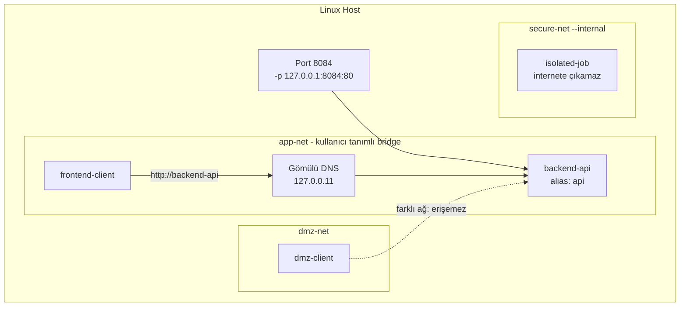
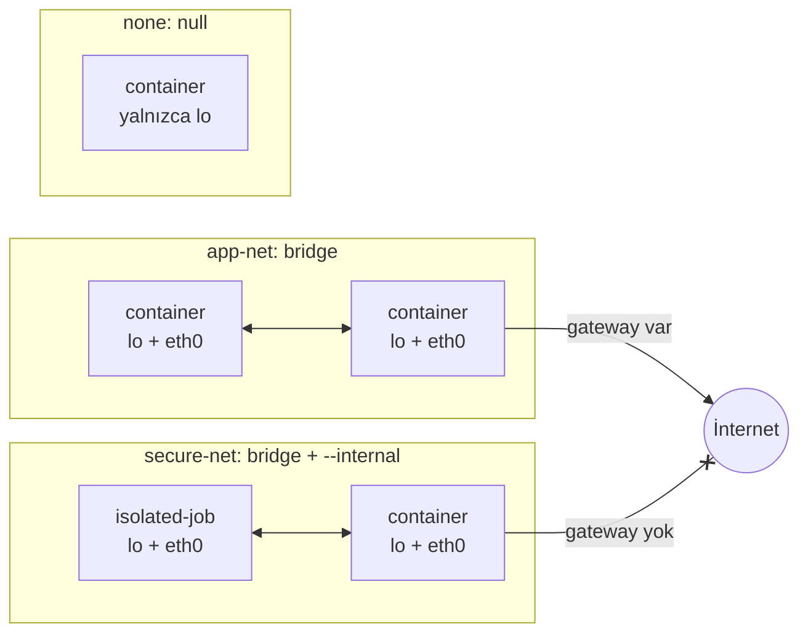

# LAB-DOC-08 — Container Ağları, Dahili DNS ve Port Yayınlama

| Profil / Araçlar | Açık Portlar |
|---|---|
| `docker network`, `nginx:alpine`, `alpine:3.20`, `python:3.12-alpine`, `curl` | 8084 (önce tüm arayüzler, sonra yalnızca 127.0.0.1), 8088 |

## Amaç

- Varsayılan `bridge` ağında container isimlerinin çözülmediğini görmek.
- Kullanıcı tanımlı ağda gömülü DNS (`127.0.0.11`) ile container'ları isimle konuşturmak.
- Alias, ağ izolasyonu ve `connect`/`disconnect` uygulamak.
- Portu yalnızca `127.0.0.1`'e yayınlamak; `host`, `none` ve `--internal` modlarını denemek.

## Ön Koşullar

- Host üzerinde **8084** ve **8088** portları boş olmalıdır.
- `host` ağ modu yalnızca Linux'ta host'un ağını paylaşır; Docker Desktop'ta farklı davranır.

## Lab Topolojisi



## Adım Adım Uygulama Rehberi

### 1. Varsayılan Bridge Ağında İsim Çözümlemesi Yok

```bash
cd ~/docker-labs/lab-08-networking-and-dns
```

```bash
docker run -d --name default-c1 alpine:3.20 sleep 3600
```

```bash
docker run -d --name default-c2 alpine:3.20 sleep 3600
```

```bash
docker exec default-c2 ping -c 2 default-c1 || echo "BASARISIZ: varsayilan bridge aginda isimle cozumleme yok"
```

```bash
docker rm -f default-c1 default-c2
```

### 2. Kullanıcı Tanımlı Ağ Oluşturma

```bash
docker network create app-net
```

```bash
docker network inspect app-net -f '{{range .IPAM.Config}}{{.Subnet}} gateway={{.Gateway}}{{end}}'
```

### 3. Container'ları İsimleriyle Konuşturma

`backend-api` container'ına ayrıca `api` takma adı verin:

```bash
docker run -d --name backend-api --network app-net --network-alias api nginx:alpine
```

```bash
docker run -d --name frontend-client --network app-net alpine:3.20 sleep 3600
```

```bash
docker exec frontend-client cat /etc/resolv.conf
```

`nameserver 127.0.0.11` satırı Docker'ın gömülü DNS sunucusudur.

```bash
docker exec frontend-client nslookup -type=a backend-api.
```

Addan sonraki nokta, sorgunun sunucunun arama alanları (`search` satırı) eklenmeden yapılmasını sağlar. Yanıtı veren sunucu `127.0.0.11`'dir.

```bash
docker exec frontend-client wget -qO- http://backend-api | grep "<title>"
```

```bash
docker exec frontend-client wget -qO- http://api | grep "<title>"
```

### 4. Ağlar Arası İzolasyon ve Canlı Bağlantı

Farklı bir ağdaki container `backend-api`'ye ulaşamaz:

```bash
docker network create dmz-net
```

```bash
docker run -d --name dmz-client --network dmz-net alpine:3.20 sleep 3600
```

```bash
docker exec dmz-client wget -T 3 -qO- http://backend-api || echo "ERISIM YOK: farkli aglar izoledir"
```

`dmz-client`'ı durdurmadan `app-net` ağına da bağlayın:

```bash
docker network connect app-net dmz-client
```

```bash
docker exec dmz-client wget -qO- http://backend-api | grep "<title>"
```

```bash
docker inspect -f '{{range $ag, $_ := .NetworkSettings.Networks}}{{$ag}} {{end}}' dmz-client
```

```bash
docker network disconnect app-net dmz-client
```

### 5. Port Yayınlama: Tüm Arayüzler ve Yalnızca Localhost

`-p 8084:80` portu sunucunun **tüm** ağ arayüzlerinde açar; sunucunun IP'sini bilen herkes erişebilir:

```bash
docker run -d --name web-public --network app-net -p 8084:80 nginx:alpine
```

```bash
docker port web-public
```

```bash
sudo ss -tlnp | grep ':8084 '
```

Çıktıda `0.0.0.0:8084` görünür. Container'ı silip yalnızca `127.0.0.1` üzerinde yayınlayın:

```bash
docker rm -f web-public
```

```bash
docker run -d --name web-local --network app-net -p 127.0.0.1:8084:80 nginx:alpine
```

```bash
sudo ss -tlnp | grep ':8084 '
```

Artık `127.0.0.1:8084` görünür; port yalnızca sunucunun kendisinden erişilebilir. Veritabanı, yönetim paneli gibi servisler bu şekilde yayınlanır.

```bash
curl -s http://127.0.0.1:8084 | grep "<title>"
```

### 6. Host Ağ Modu

`--network host` ile container host'un ağını doğrudan kullanır. `-p` gerekmez:

```bash
docker run -d --name host-web --network host python:3.12-alpine python3 -m http.server 8088
```

```bash
curl -s -o /dev/null -w "HTTP %{http_code}\n" http://localhost:8088
```

```bash
docker rm -f host-web
```

### 7. None ve Internal Ağlar



Bu üç seçenek container'ın dışarıyla bağını farklı ölçüde keser:

| Ağ | Container'daki arayüzler | Kime ulaşabilir? |
|---|---|---|
| Normal ağ (`app-net`) | `lo` + `eth0` | Aynı ağdaki container'lar ve internet |
| `--internal` ağ | `lo` + `eth0` | Yalnızca aynı ağdaki container'lar; internete çıkış yok |
| `none` | Yalnızca `lo` | Yalnızca kendisi |

`lo` (loopback, `127.0.0.1`) her container'da vardır ve yalnızca container'ın kendi içindir: container içindeki `127.0.0.1` host değil, container'ın kendisidir. Ağ bağlantısı `eth0` ile gelir.

`none` ile `--internal` aynı şey değildir:

- `none`, Docker'la gelen hazır bir ağdır ve sürücüsü `null`'dır: container'a hiç ağ arayüzü verilmez.
- `--internal` bir ağ türü değil, `docker network create` komutunun bir **parametresidir**. Sürücü belirtilmediği için ağ varsayılan `bridge` sürücüsüyle kurulur; `--internal` bu bridge ağına gateway verilmemesini söyler. Container'lar IP alır ve birbirini görür, yalnızca dışarı çıkış kapalıdır. `docker network create --internal secure-net` ile `docker network create --driver bridge --internal secure-net` aynı komuttur.

`none` ağında yalnızca `lo` vardır, `eth0` yoktur:

```bash
docker run --rm --network none alpine:3.20 ip addr
```

Internal bir ağ oluşturun:

```bash
docker network create --internal secure-net
```

Sürücüyü ve internal ayarını görün; `none` ağıyla karşılaştırın:

```bash
docker network inspect secure-net none -f '{{.Name}} driver={{.Driver}} internal={{.Internal}}'
```

```text
secure-net driver=bridge internal=true
none driver=null internal=false
```

Ağda bir container başlatın:

```bash
docker run -d --name isolated-job --network secure-net alpine:3.20 sleep 3600
```

Aynı ağdaki container'lar birbirine isimle ulaşır:

```bash
docker run --rm --network secure-net alpine:3.20 ping -c 1 -W 2 isolated-job
```

Karşılaştırma için normal ağdan internete ping atın. DNS karışmasın diye isim yerine IP adresi (`1.1.1.1`) kullanılır:

```bash
docker run --rm --network app-net alpine:3.20 ping -c 1 -W 2 1.1.1.1
```

Aynı komut internal ağda başarısız olur; Docker bu ağa dışarı çıkan bir yol (gateway) vermez:

```bash
docker run --rm --network secure-net alpine:3.20 ping -c 1 -W 2 1.1.1.1 || echo "INTERNET YOK: internal ag disari kapali"
```

Veritabanı veya yalnızca iç işlem yapan servisler internal ağa konur: birbirleriyle konuşurlar ama dışarı veri gönderemezler.

## Temizlik

```bash
docker rm -f backend-api frontend-client dmz-client web-public web-local host-web isolated-job 2>/dev/null || true
```

```bash
docker network rm app-net dmz-net secure-net 2>/dev/null || true
```
