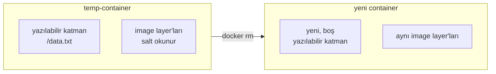
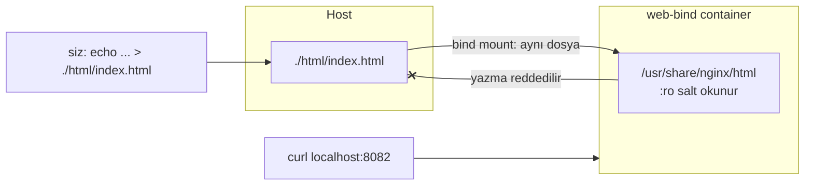
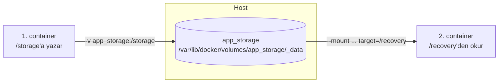

# LAB-DOC-09 — Depolama: Bind Mount, Named Volume ve tmpfs

| Profil / Araçlar | Açık Portlar |
|---|---|
| `docker volume`, `nginx:alpine`, `postgres:17-alpine`, `alpine:3.20`, `curl` | 8082 |

## Amaç

- Volume olmadan verinin container'la birlikte silindiğini görmek.
- Bind mount, named volume ve tmpfs'i doğru yerde kullanmak.
- PostgreSQL verisinin volume sayesinde korunduğunu kanıtlamak.

## Ön Koşullar

- Host üzerinde **8082** portu boş olmalıdır.

## Kavramlar

Container'ın yazdığı veri dört yerde durabilir:

| Tür | Veri nerede? | Yerini kim belirler? | Container silinince | Ne için? |
|---|---|---|---|---|
| Yazılabilir katman | Container'ın içinde | Docker | Silinir | Geçici dosyalar |
| Bind mount | Host'ta seçtiğiniz klasör | Siz | Kalır | Kod, config dosyası |
| Named volume | `/var/lib/docker/volumes/` altında | Docker | Kalır | Veritabanı, kalıcı veri |
| tmpfs | Host'un RAM'i | Docker | Silinir (restart'ta da) | Token, geçici gizli veri |

## Adım Adım Uygulama Rehberi

### 1. Volume Olmadan Veri Kaybı



Container'ın yazdığı her şey, image'ın üstündeki yazılabilir katmana gider. Bu katman container'a aittir ve `docker rm` ile birlikte silinir. Aynı image'dan başlayan yeni container boş bir katmanla başlar.

```bash
cd ~/docker-labs/lab-09-storage-bind-mount-vs-volume
```

```bash
docker run --name temp-container alpine:3.20 sh -c "echo 'Kritik veri' > /data.txt && cat /data.txt"
```

```bash
docker rm temp-container
```

```bash
docker run --rm alpine:3.20 cat /data.txt || echo "VERI KAYBOLDU: yazilabilir katman konteynerle birlikte silindi"
```

### 2. Bind Mount ile Canlı Dosya Güncelleme



Bind mount, host'taki bir klasörü container'ın içine olduğu gibi bağlar; kopya yoktur, iki taraf aynı dosyayı görür. Host'ta dosyayı değiştirdiğinizde container hemen yeni hâlini görür. Klasörün yolunu siz verirsiniz (`$(pwd)/html`).

```bash
mkdir -p ./html
```

```bash
echo "<h1>Bind Mount Calisiyor</h1>" > ./html/index.html
```

`:ro` bağlamayı container için salt okunur yapar:

```bash
docker run -d --name web-bind -p 8082:80 -v "$(pwd)/html:/usr/share/nginx/html:ro" nginx:alpine
```

```bash
curl -s http://localhost:8082
```

Container'ı yeniden başlatmadan host'taki dosyayı değiştirin:

```bash
echo "<h1>Kod Degisti</h1>" > ./html/index.html
```

```bash
curl -s http://localhost:8082
```

Container içinden yazmayı deneyin; `:ro` nedeniyle reddedilir:

```bash
docker exec web-bind sh -c 'echo test > /usr/share/nginx/html/x.html' || echo "SALT OKUNUR: konteyner bind mount'a yazamaz"
```

### 3. Named Volume ve Host'taki Konumu



Named volume'ü Docker oluşturur ve yerini Docker belirler. Volume container'dan bağımsızdır: container silinse de kalır, başka bir container'a bağlanabilir. `-v ad:/yol` ile `--mount type=volume,source=ad,target=/yol` aynı işi yapar; `--mount` daha uzun ama her alanı adıyla yazar.

```bash
docker volume create app_storage
```

```bash
docker run --rm -v app_storage:/storage alpine:3.20 sh -c "echo 'Musteri kaydi' > /storage/musteri.db"
```

```bash
docker volume inspect app_storage -f '{{.Mountpoint}}'
```

```bash
sudo ls -l "$(docker volume inspect app_storage -f '{{.Mountpoint}}')"
```

Yeni bir container aynı volume'ü bağlayarak veriyi okur:

```bash
docker run --rm --mount type=volume,source=app_storage,target=/recovery alpine:3.20 cat /recovery/musteri.db
```

### 4. PostgreSQL Verisinin Kalıcılığı


PostgreSQL verisini `/var/lib/postgresql/data` klasörüne yazar. Bu klasörü bir volume'e bağlarsak veri container'da değil volume'de durur. Aşağıda bir tablo oluşturup container'ı sileceğiz, sonra yeni bir container'la aynı tabloyu okuyacağız.

Veriyi tutacak volume'ü oluşturun:

```bash
docker volume create pgdata
```

PostgreSQL container'ını başlatın. `-e POSTGRES_PASSWORD` image'ın zorunlu tuttuğu yönetici parolasıdır; `-v pgdata:/var/lib/postgresql/data` veri klasörünü volume'e bağlar:

```bash
docker run -d --name store-db -e POSTGRES_PASSWORD='DevOps2026!' -v pgdata:/var/lib/postgresql/data postgres:17-alpine
```

PostgreSQL ilk açılışta veri klasörünü hazırlar; bu birkaç saniye sürer. `pg_isready` veritabanı bağlantı kabul edene kadar bekler:

```bash
until docker exec store-db pg_isready -h 127.0.0.1 -U postgres >/dev/null 2>&1; do sleep 1; done
```

`psql` ile bir tablo oluşturup içine bir satır ekleyin:

```bash
docker exec store-db psql -U postgres -c "CREATE TABLE users (name text); INSERT INTO users VALUES ('student');"
```

Çıktıda `CREATE TABLE` ve `INSERT 0 1` görünür.

Container'ı silin. `-f` çalışan container'ı durdurup siler; volume'e dokunulmaz:

```bash
docker rm -f store-db
```

Aynı volume'ü bağlayan yeni bir container başlatın. Farklı bir isim verdik ki eski container olmadığı açıkça görülsün:

```bash
docker run -d --name store-db-recovered -e POSTGRES_PASSWORD='DevOps2026!' -v pgdata:/var/lib/postgresql/data postgres:17-alpine
```

Bu kez veri klasörü dolu olduğu için PostgreSQL hazırlık yapmaz, var olan veriyi açar. Hazır olmasını bekleyin:

```bash
until docker exec store-db-recovered pg_isready -h 127.0.0.1 -U postgres >/dev/null 2>&1; do sleep 1; done
```

Tabloyu okuyun; `-t` yalnızca satırları yazar, başlık ve satır sayısını yazmaz:

```bash
docker exec store-db-recovered psql -U postgres -t -c "SELECT name FROM users;"
```

Çıktıda `student` görünür: container silindi ama veri volume'de kaldı.

### 5. tmpfs: Bellek İçi Depolama


tmpfs diske hiç yazılmaz, yalnızca RAM'de durur. Container durunca ya da yeniden başlayınca içerik silinir. Token gibi diske düşmemesi gereken geçici veriler için kullanılır. `size=64m` RAM kullanımını sınırlar, `noexec` buradaki dosyaların program olarak çalıştırılmasını engeller.

```bash
docker run -d --name ram-app --tmpfs /ramdisk:rw,noexec,nosuid,size=64m alpine:3.20 sleep 3600
```

```bash
docker exec ram-app df -h /ramdisk
```

```bash
docker exec ram-app sh -c 'echo gizli > /ramdisk/token && cat /ramdisk/token'
```

Container yeniden başlatıldığında tmpfs içeriği silinir:

```bash
docker restart ram-app
```

```bash
docker exec ram-app ls /ramdisk
```

## Temizlik

```bash
docker rm -f web-bind store-db store-db-recovered ram-app 2>/dev/null || true
```

```bash
docker volume rm app_storage pgdata 2>/dev/null || true
```

```bash
rm -rf ./html
```
