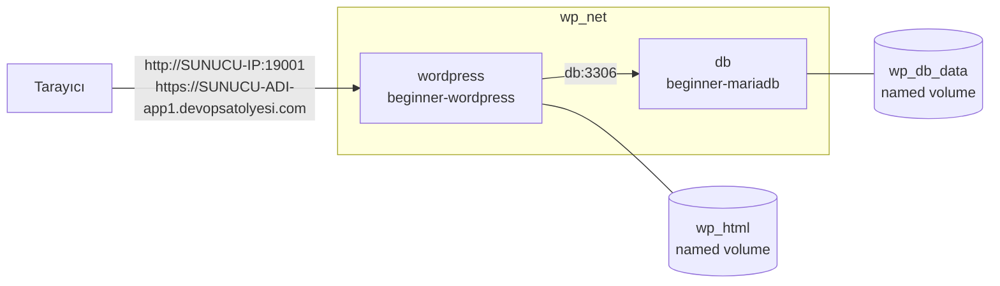

# LAB-DOC-10 — Docker Compose Hızlı Başlangıç: WordPress ve MariaDB

| Profil / Araçlar | Açık Portlar |
|---|---|
| `docker compose`, `wordpress:6-apache`, `mariadb:10.11`, `curl` | 19001 |

## Amaç

- Birden çok `docker run` komutu yerine tek bir `docker-compose.yaml` dosyasıyla web uygulaması ve veritabanını birlikte çalıştırmak.
- Compose dosyasındaki `services`, `networks`, `volumes`, `environment`, `depends_on` ve `healthcheck` bloklarının görevini öğrenmek.
- Gizli bilgileri ve portları `.env` dosyasından okumak.
- WordPress'in veritabanı sağlıklı olana kadar başlamamasını sağlamak.

## Ön Koşullar

- Host üzerinde **19001** portu boş olmalıdır. Doluysa: `docker ps --filter publish=19001`

## Lab Topolojisi



## Compose Dosyası: Hangi Satır Ne İşe Yarıyor?

`docker-compose.yaml` iki servisi (`wordpress`, `db`), verilerin tutulacağı volume'leri ve servislerin konuştuğu ağı tek dosyada tanımlar.

**WordPress servisi:**

```yaml
name: wp

services:
  wordpress:
    image: wordpress:6-apache
    container_name: beginner-wordpress
    restart: unless-stopped
    ports:
      - "${APP_PORT:-19001}:80"
    environment:
      WORDPRESS_DB_HOST: db:3306
      WORDPRESS_DB_USER: ${MYSQL_USER:?.env dosyasi eksik}
      WORDPRESS_DB_PASSWORD: ${MYSQL_PASSWORD:?.env dosyasi eksik}
      WORDPRESS_DB_NAME: ${MYSQL_DATABASE:?.env dosyasi eksik}
    volumes:
      - html:/var/www/html
    depends_on:
      db:
        condition: service_healthy
    networks:
      - net
```

- `name: wp`: proje adı. Compose, oluşturduğu ağ ve volume adlarının önüne bunu ekler: `wp_net`, `wp_db_data`, `wp_html`. Yazılmazsa klasör adı kullanılır ve adlar çok uzar.
- `container_name`: container'ın adı. Yazılmazsa compose `wp-wordpress-1` gibi bir ad verir.
- `restart: unless-stopped`: container çökerse ya da sunucu yeniden başlarsa Docker onu tekrar başlatır; siz durdurduysanız başlatmaz.
- `ports`: host'un `19001` portunu container'ın `80` portuna bağlar. `${APP_PORT:-19001}`, `.env`'de `APP_PORT` yoksa `19001` kullanır.
- `WORDPRESS_DB_HOST: db:3306`: `db`, aşağıdaki veritabanı servisinin adıdır. Compose ağında servis adı DNS adı olarak çözülür (LAB-08); IP yazmaya gerek yoktur.
- `${MYSQL_USER:?.env dosyasi eksik}`: değer `.env`'den gelir. `.env`'de yoksa compose boş değerle devam etmez, durur ve bu mesajı yazar.
- `html:/var/www/html`: WordPress dosyaları (eklentiler, yüklenen resimler) volume'de tutulur.
- `depends_on` + `service_healthy`: WordPress, `db` servisi `healthy` olmadan başlatılmaz. Yalnızca `depends_on: [db]` yazmak, veritabanı container'ının başlamasını bekler ama hazır olmasını beklemez.

**Veritabanı servisi, volume'ler ve ağ:**

```yaml
  db:
    image: mariadb:10.11
    container_name: beginner-mariadb
    restart: unless-stopped
    environment:
      MARIADB_DATABASE: ${MYSQL_DATABASE:?.env dosyasi eksik}
      MARIADB_USER: ${MYSQL_USER:?.env dosyasi eksik}
      MARIADB_PASSWORD: ${MYSQL_PASSWORD:?.env dosyasi eksik}
      MARIADB_ROOT_PASSWORD: ${MYSQL_ROOT_PASSWORD:?.env dosyasi eksik}
    volumes:
      - db_data:/var/lib/mysql
    healthcheck:
      test: ["CMD", "healthcheck.sh", "--connect", "--innodb_initialized"]
      interval: 5s
      timeout: 5s
      retries: 10
      start_period: 10s
    networks:
      - net

volumes:
  db_data:
  html:

networks:
  net:
```

- `MARIADB_*`: MariaDB ilk açılışta bu değerlerle veritabanını ve kullanıcıyı oluşturur. WordPress de aynı `.env` değişkenleriyle bağlandığı için iki tarafın bilgileri her zaman aynıdır.
- `db_data:/var/lib/mysql`: MariaDB'nin veri klasörü volume'dedir; container silinse de veri kalır.
- `db` servisinde `ports` yoktur: veritabanı host'a açılmaz, yalnızca `net` ağındaki WordPress ona ulaşır.
- `healthcheck`: Docker'ın servisin gerçekten hazır olup olmadığını sınadığı komuttur.
  - `healthcheck.sh`: MariaDB image'ıyla gelen betik. `--connect` bağlantı kabul ediliyor mu, `--innodb_initialized` depolama motoru hazır mı diye bakar.
  - `interval: 5s`: 5 saniyede bir sınar. `timeout: 5s`: 5 saniyede cevap gelmezse başarısız sayar.
  - `retries: 10`: art arda 10 başarısız denemede servis `unhealthy` olur.
  - `start_period: 10s`: ilk 10 saniyedeki başarısızlıkları saymaz; veritabanının açılması zaman alır.
- En alttaki `volumes:` ve `networks:` bölümleri, servislerin kullandığı volume'leri ve ağı tanımlar; compose bunları ilk `up` komutunda oluşturur.

## Adım Adım Uygulama Rehberi

### 1. .env Dosyasını Oluşturma

```bash
cd ~/docker-labs/lab-10-docker-compose-quickstart
```

```bash
cp .env.example .env
```

```bash
cat .env
```

`.env` gerçek ortamda gizli bilgi içerir ve git'e eklenmez. Depoda yalnızca örnek dosya (`.env.example`) tutulur.

### 2. Yapılandırmayı Doğrulama

`docker compose config`, `.env` değerlerini compose dosyasına yerleştirir; YAML hatası ya da eksik değişken varsa burada durur. Yalnızca veritabanı değişkenlerine bakın; `${MYSQL_...}` yerine `.env`'deki değerler yazılmış olmalıdır:

```bash
docker compose config | grep -E "MARIADB_|WORDPRESS_DB_"
```

Hata mesajının sonunda `.env dosyasi eksik` yazıyorsa 1. adımdaki `cp` komutunu çalıştırın.

### 3. Stack'i Başlatma

```bash
docker compose up -d
```

Komut, container'lar hazır olana kadar ekranda kalır. Çıktıda sırayı görürsünüz: compose önce `beginner-mariadb`'yi başlatır, `Healthy` olmasını bekler, ardından `beginner-wordpress`'i başlatır. Bunu `depends_on: condition: service_healthy` sağlar.

```bash
docker compose ps
```

İki container da `Up` durumundadır; `beginner-mariadb` satırında `(healthy)` yazar.

### 4. Logları İnceleme

```bash
docker compose logs --tail 20 db
```

```bash
docker compose logs --tail 20 wordpress
```

### 5. Web Arayüzünü Test Etme

```bash
curl -s -o /dev/null -w "HTTP %{http_code} -> %{redirect_url}\n" http://localhost:19001
```

WordPress kurulmamış olduğu için kurulum sayfasına (`/wp-admin/install.php`) yönlendirir.

```bash
curl -s http://localhost:19001/wp-admin/install.php | grep -o "<title>.*</title>"
```

Tarayıcıdan erişim adresleri:

```bash
echo "http://$(curl -s ifconfig.me):19001"
```

```bash
echo "https://$(hostname)-app1.devopsatolyesi.com"
```

### 6. Compose ile Container İçinde Komut Çalıştırma

```bash
docker compose exec db mariadb -u root -p"$(grep MYSQL_ROOT_PASSWORD .env | cut -d= -f2)" -e "SHOW DATABASES;"
```

### 7. Durdurma ve Verinin Korunması

`down`, container'ları ve ağı siler; volume'leri silmez:

```bash
docker compose down
```

```bash
docker volume ls --filter name=wp_
```

```bash
docker compose up -d
```

## Temizlik

`-v`, compose dosyasında tanımlı volume'leri de siler:

```bash
docker compose down -v
```

```bash
rm -f .env
```
