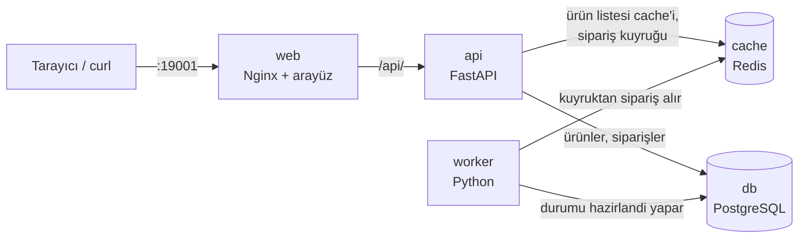

# LAB-DOC-11 — Docker Compose Pratiği: Kendi Servisleriyle Çok Katmanlı Uygulama

| Profil / Araçlar | Açık Portlar |
|---|---|
| `docker compose`, `nginx:1.27-alpine`, FastAPI, Python, `redis:7.4-alpine`, `postgres:16-alpine`, `curl` | 19001 |

## Amaç

- Kendi Dockerfile'ı olan üç servisi (`web`, `api`, `worker`) Redis ve PostgreSQL ile birlikte tek compose dosyasından build edip çalıştırmak.
- Tek bir servisin loglarına bakmak, onu durdurup başlatmak, kodunu değiştirip yalnızca onu yeniden build etmek.
- `worker` servisini ölçeklendirip işi birden çok container'a dağıtmak.
- Ağ ayrımını ve volume ile verinin korunduğunu görmek.

## Ön Koşullar

- LAB-10 (compose dosyası, `.env`, `healthcheck` ve `depends_on`).
- Host üzerinde **19001** portu boş olmalıdır. Doluysa: `docker ps --filter publish=19001`

## Uygulama

Küçük bir mağaza: ürün eklenir, sipariş verilir, siparişi arka plandaki `worker` hazırlar.



| Servis | Image | Görevi |
|---|---|---|
| `web` | Kendi Dockerfile'ı (`services/web`) | Arayüzü (`index.html`) sunar, `/api/` isteklerini `api`'ye iletir. Dışarı açık tek servis. |
| `api` | Kendi Dockerfile'ı (`services/api`) | Ürün ve sipariş API'si. Siparişi veritabanına `beklemede` olarak yazar ve Redis kuyruğuna koyar. |
| `worker` | Kendi Dockerfile'ı (`services/worker`) | Kuyruktan siparişi alır, 1 saniyede hazırlar, durumunu `hazirlandi` yapar. Portu yoktur. |
| `cache` | `redis:7.4-alpine` | Ürün listesi için 30 saniyelik cache ve sipariş kuyruğu. |
| `db` | `postgres:16-alpine` | Ürünler ve siparişler. |

<details>
<summary><strong>Klasör yapısı</strong></summary>

```text
lab-11-docker-compose-stack/
├── docker-compose.yaml
├── .env.example
└── services/
    ├── web/      Dockerfile, nginx.conf, index.html
    ├── api/      Dockerfile, main.py, requirements.txt
    └── worker/   Dockerfile, worker.py, requirements.txt
```

</details>

## Compose Dosyası: Önemli Satırlar

Dosyanın kısaltılmış hâli (tamamı 1. adımda):

```yaml
name: shop

services:
  web:
    build: ./services/web
    ports:
      - "${WEB_PORT:-19001}:80"
    networks: [public]
  api:
    build: ./services/api
    env_file: .env
    networks: [public, internal]
  worker:
    build: ./services/worker
    env_file: .env
    networks: [internal]
  cache:
    image: redis:7.4-alpine
  db:
    image: postgres:16-alpine

networks:
  internal:
    internal: true
```

- `build: ./services/web`: image hazır çekilmez, o klasördeki Dockerfile'dan build edilir. `image:` yazan servisler (Redis, PostgreSQL) Docker Hub'dan çekilir.
- `name: shop`: proje adı. Build edilen image'lar `shop-web`, container'lar `shop-web-1`, volume'ler `shop_db_data` adını alır.
- `container_name` yazılmadı: compose adları kendisi verir. Bu sayede 8. adımda `worker`'dan birden çok container çalıştırılabilir; sabit bir ad iki container'a verilemez.
- `env_file: .env`: `.env`'deki bütün değişkenler container'a ortam değişkeni olarak verilir. `.env` yoksa compose başlamadan hata verir.
- `worker`'da `ports` yoktur: dışarıdan istek almaz, işini kuyruktan alır.
- Ağlar: `web` yalnızca `public`, `cache`, `db` ve `worker` yalnızca `internal` ağındadır; `api` ikisine de bağlıdır. `internal: true` bu ağdan internete çıkışı kapatır (LAB-08).
- `healthcheck` ve `depends_on` LAB-10'daki gibidir: `api`, Redis ve PostgreSQL hazır olmadan; `web` ve `worker` de `api` hazır olmadan başlatılmaz.

## Adım Adım Uygulama Rehberi

### 1. Dosyaları Hazırlama

```bash
cd ~/docker-labs/lab-11-docker-compose-stack
```

```bash
cp .env.example .env
```

```bash
cat docker-compose.yaml
```

### 2. Image'ları Build Etme

`docker compose build`, `build:` satırı olan üç servisin image'ını üretir. Redis ve PostgreSQL build edilmez, ilk `up` komutunda çekilir:

```bash
docker compose build
```

Build edilen image'lar proje adı ve servis adıyla isimlenir:

```bash
docker images --filter reference='shop-*'
```

Listede `shop-web`, `shop-api` ve `shop-worker` görünür.

### 3. Stack'i Başlatma

`--wait`, healthcheck'i olan servisler `healthy` olana kadar bekler; ayrıca `sleep` gerekmez:

```bash
docker compose up -d --wait
```

```bash
docker compose ps
```

Beş container çalışır: `shop-web-1`, `shop-api-1`, `shop-worker-1`, `shop-cache-1`, `shop-db-1`. Sondaki `-1`, servisin kaçıncı container'ı olduğunu gösterir.

### 4. Uygulamayı Kullanma

Tarayıcıdan açılacak adres:

```bash
echo "https://$(hostname)-app1.devopsatolyesi.com"
```

Aynı işleri `curl` ile de yapabilirsiniz. İki ürün ekleyin:

```bash
curl -s -X POST "http://localhost:19001/api/v1/products?title=DevOps%20Kitabi&price=450"
```

```bash
curl -s -X POST "http://localhost:19001/api/v1/products?title=Kubernetes%20Rehberi&price=520"
```

Ürün listesini iki kez okuyun. İlki veritabanından (`postgresql_database`), 30 saniye içindeki ikincisi Redis cache'inden (`redis_cache`) gelir:

```bash
curl -s http://localhost:19001/api/v1/products | grep -o '"source":"[a-z_]*"'
```

```bash
curl -s http://localhost:19001/api/v1/products | grep -o '"source":"[a-z_]*"'
```

Bir sipariş verin. `api` siparişi `beklemede` olarak kaydeder ve kuyruğa koyar:

```bash
curl -s -X POST "http://localhost:19001/api/v1/orders?product_id=1&qty=2"
```

`worker` siparişi kuyruktan alıp hazırlar. Yalnızca `worker` servisinin loglarına bakın:

```bash
docker compose logs --tail 3 worker
```

Son satırda `siparis 1 hazirlandi` görünür. Siparişin durumu değişmiştir:

```bash
curl -s http://localhost:19001/api/v1/orders
```

### 5. Servis Loglarına Bakma

`docker compose logs <servis>` yalnızca o servisin loglarını gösterir; servis adı yazılmazsa hepsi gelir ve her satırın başında hangi container'dan geldiği yazar.

`api`'ye gelen istekler:

```bash
docker compose logs --tail 5 api
```

`web` (Nginx) erişim logları:

```bash
docker compose logs --tail 5 web
```

`-f` logları canlı izler. Tarayıcıdan sipariş verirseniz satırların geldiğini görürsünüz; çıkmak için `Ctrl+C`:

```bash
docker compose logs -f --tail 3 worker
```

### 6. Tek Servisi Durdurup Başlatma

Yalnızca `worker`'ı durdurun; diğer servisler çalışmaya devam eder:

```bash
docker compose stop worker
```

`ps` normalde yalnızca çalışan container'ları gösterir; `-a` durmuş olanları da gösterir:

```bash
docker compose ps -a worker
```

Durum `Exited` olur. Site çalışmaya devam eder, sipariş de alınır. İki sipariş verin:

```bash
for i in 1 2; do curl -s -X POST "http://localhost:19001/api/v1/orders?product_id=2&qty=1"; echo; done
```

Siparişleri işleyen olmadığı için kuyrukta beklerler. `exec` ile Redis container'ında kuyruk uzunluğuna bakın:

```bash
docker compose exec cache redis-cli LLEN orders
```

Çıktı `2` olur; siparişlerin durumu `beklemede`dir. `worker`'ı yeniden başlatın:

```bash
docker compose start worker
```

`worker` açılınca kuyrukta bekleyen iki siparişi işler:

```bash
docker compose logs --tail 3 worker
```

```bash
docker compose exec cache redis-cli LLEN orders
```

Kuyruk boşalır (`0`). `docker compose restart worker`, durdurup başlatmayı tek komutta yapar.

### 7. Kodu Değiştirip Tek Servisi Yeniden Build Etme

API'nin sürümü şu an `1.0`:

```bash
curl -s http://localhost:19001/api/v1/info
```

Koddaki sürümü `1.1` yapın:

```bash
sed -i 's/VERSION = "1.0"/VERSION = "1.1"/' services/api/main.py
```

`up -d --build api` yalnızca `api` image'ını yeniden build eder ve yalnızca `api` container'ını yeniden oluşturur:

```bash
docker compose up -d --build api
```

`api` birkaç saniyedir, diğerleri dakikalardır çalışıyor:

```bash
docker compose ps --format '{{.Service}} {{.Status}}'
```

Yeni sürüm yayında:

```bash
curl -s http://localhost:19001/api/v1/info
```

Yeni `api` container'ı farklı bir IP alabilir. `web`'in Nginx ayarı (`services/web/nginx.conf`) `api` adını her istekte Docker'ın DNS'inden yeniden çözdüğü için `web`'i yeniden başlatmak gerekmez.

### 8. Worker'ı Ölçeklendirme

`--scale worker=3`, `worker` servisinden üç container çalıştırır:

```bash
docker compose up -d --scale worker=3
```

```bash
docker compose ps worker
```

`shop-worker-1`, `shop-worker-2` ve `shop-worker-3` görünür. Altı sipariş verin:

```bash
for i in 1 2 3 4 5 6; do curl -s -o /dev/null -X POST "http://localhost:19001/api/v1/orders?product_id=1&qty=1"; done
```

Siparişler üç container arasında paylaşılır; satır başındaki `worker-1`, `worker-2`, `worker-3` hangisinin işlediğini gösterir:

```bash
docker compose logs worker | grep hazirlandi | tail -n 6
```

Tek container'a geri dönün:

```bash
docker compose up -d --scale worker=1
```

Bu yalnızca port yayınlamayan servislerde çalışır: `web`'i ölçeklendirseydik üç container da host'un `19001` portunu isterdi.

### 9. Ağ Ayrımı

`web` yalnızca `public` ağındadır; veritabanı adını bile çözemez:

```bash
docker compose exec web ping -c 1 -W 2 db || echo "IZOLE: web veritabani agina erisemiyor"
```

Host'ta yalnızca `web`'in portu açıktır:

```bash
docker compose ps --format '{{.Service}} -> {{.Ports}}'
```

### 10. Verinin Kalıcılığı

`down` container'ları ve ağları siler, volume'lere dokunmaz:

```bash
docker compose down
```

```bash
docker volume ls --filter name=shop_
```

```bash
docker compose up -d --wait
```

Ürünler ve siparişler `shop_db_data` volume'ünden geri gelir:

```bash
curl -s http://localhost:19001/api/v1/orders
```

## Temizlik

`-v` volume'leri, `--rmi local` compose'un build ettiği `shop-web`, `shop-api` ve `shop-worker` image'larını da siler:

```bash
docker compose down -v --rmi local
```

Koddaki sürümü geri alın:

```bash
sed -i 's/VERSION = "1.1"/VERSION = "1.0"/' services/api/main.py
```

```bash
rm -f .env
```
