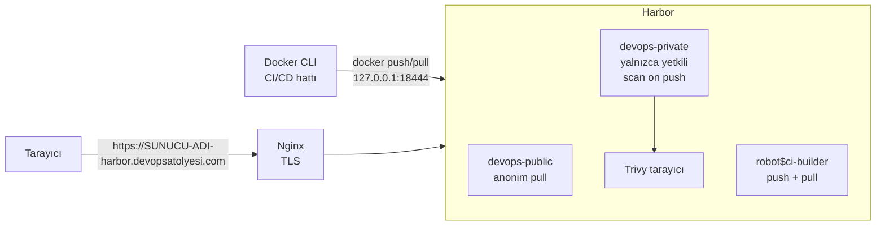

# LAB-DOC-15 — Kurumsal Registry: Harbor ile Projeler, Robot Hesap, Değiştirilemez Tag ve Trivy

| Profil / Araçlar | Açık Portlar |
|---|---|
| Harbor 2.x, `docker login/push/pull`, Harbor REST API, `curl`, `jq` | 18444 (Harbor) |

## Amaç

- Harbor'da public ve private proje oluşturup erişimi doğrulamak.
- CI/CD için süreli bir robot hesap kullanmak.
- Tag immutability ile yayınlanmış sürümün üzerine yazılmasını engellemek.
- Harbor'daki Trivy ile push edilen image'ı taramak.

## Ön Koşullar

- Harbor 18444 portunda çalışıyor olmalıdır. Eğitim sunucusunda hazırdır; değilse aşağıdaki bölümle kurun.
- `curl` ve `jq` kurulu olmalıdır.

Harbor'ın çalıştığını kontrol edin; çıktıda sürüm (`v2.x.x`) görünmelidir:

```bash
curl -s http://127.0.0.1:18444/api/v2.0/systeminfo | jq -r .harbor_version
```

<details>
<summary><strong>Ortamda Harbor kurulu değilse</strong></summary>

Harbor, kendi `docker-compose.yml` dosyasıyla çalışan yaklaşık on container'dan oluşur (portal, core, registry, veritabanı, Redis, Trivy ...). En az 4 GB boş RAM ister.

**Kurulu ama durmuşsa** (`/opt/harbor` klasörü varsa), kendi compose dosyasıyla başlatın. Image'lar sunucuda yoksa önce indirilir; birkaç dakika sürer:

```bash
cd /opt/harbor && sudo docker compose up -d
```

**Hiç kurulu değilse**, lab klasöründeki `install_harbor.sh` betiğini çalıştırın:

```bash
cd ~/docker-labs/lab-15-enterprise-harbor-registry
```

```bash
sudo HARBOR_ADMIN_PASSWORD='Harbor12345' bash ./install_harbor.sh
```

Betik sırasıyla şunları yapar:

- Harbor'ın resmi kurulum paketini (`harbor-online-installer`) GitHub'dan indirip `/opt/harbor` altına açar.
- `harbor.yml` dosyasında portu `18444`, admin parolasını ve veri klasörünü (`/opt/harbor/data`) ayarlar. HTTPS'i kapatır; TLS önündeki Nginx'te sonlanır.
- Harbor'ın istediği alan adını (`harbor.lab.local`) `/etc/hosts` dosyasına ekler.
- Harbor'ın kendi `prepare` ve `install.sh --with-trivy` betiklerini çalıştırır: compose dosyasını üretir, image'ları indirir ve container'ları başlatır.

Kurulum bitince yukarıdaki `systeminfo` komutunu tekrar çalıştırın. Docker, `127.0.0.1` adresindeki registry'lere TLS olmadan bağlanabildiği için `/etc/docker/daemon.json` dosyasında değişiklik gerekmez.

</details>

## Lab Topolojisi



## Adım Adım Uygulama Rehberi

### 1. Harbor'a Erişim

```bash
cd ~/docker-labs/lab-15-enterprise-harbor-registry
```

```bash
curl -s http://127.0.0.1:18444/api/v2.0/systeminfo | jq '{harbor_version, auth_mode}'
```

```bash
echo "https://$(hostname)-harbor.devopsatolyesi.com"
```

Bu adresi tarayıcıda açın ve `admin` kullanıcısıyla giriş yapın. API komutları için bilgileri değişkene alın:

```bash
HARBOR=http://127.0.0.1:18444
```

```bash
HARBOR_USER=admin
```

```bash
HARBOR_PASS='Harbor12345'
```

### 2. Public ve Private Proje Oluşturma

Arayüzden: **Projects → New Project**

- `devops-public`: **Access Level → Public** işaretli.
- `devops-private`: **Public** işaretsiz.

Aynı işlem API ile (`auto_scan`, push edilen image'ları otomatik taratır):

```bash
curl -s -o /dev/null -w "devops-public: HTTP %{http_code}\n" -u "${HARBOR_USER}:${HARBOR_PASS}" \
  -H "Content-Type: application/json" -X POST "${HARBOR}/api/v2.0/projects" \
  -d '{"project_name": "devops-public", "metadata": {"public": "true"}}'
```

```bash
curl -s -o /dev/null -w "devops-private: HTTP %{http_code}\n" -u "${HARBOR_USER}:${HARBOR_PASS}" \
  -H "Content-Type: application/json" -X POST "${HARBOR}/api/v2.0/projects" \
  -d '{"project_name": "devops-private", "metadata": {"public": "false", "auto_scan": "true"}}'
```

`HTTP 201` proje oluşturuldu, `409` zaten var demektir.

### 3. CI/CD Robot Hesabı

Arayüzden: **Administration → Robot Accounts → New Robot Account**, adı `ci-builder`, süre 30 gün, iki projede de **Push** ve **Pull** yetkisi. Kaydedince gösterilen secret yalnızca bir kez görünür.

Aynı işlem API ile; secret doğrudan değişkene alınır ve ekrana basılmaz:

```bash
ROBOT_JSON=$(curl -s -u "${HARBOR_USER}:${HARBOR_PASS}" -H "Content-Type: application/json" \
  -X POST "${HARBOR}/api/v2.0/robots" -d '{
    "name": "ci-builder", "level": "system", "duration": 30,
    "permissions": [
      {"kind": "project", "namespace": "devops-public",  "access": [{"resource": "repository", "action": "push"}, {"resource": "repository", "action": "pull"}]},
      {"kind": "project", "namespace": "devops-private", "access": [{"resource": "repository", "action": "push"}, {"resource": "repository", "action": "pull"}]}
    ]}')
```

```bash
ROBOT_USER=$(echo "${ROBOT_JSON}" | jq -r .name)
```

```bash
ROBOT_SECRET=$(echo "${ROBOT_JSON}" | jq -r .secret)
```

```bash
echo "Robot kullanici adi: ${ROBOT_USER}"
```

### 4. Robot Hesapla Giriş ve Push

Robot adı `$` içerdiği için değişkenden okunur; doğrudan yazılacaksa tek tırnak kullanılır (`'robot$ci-builder'`):

```bash
echo "${ROBOT_SECRET}" | docker login 127.0.0.1:18444 -u "${ROBOT_USER}" --password-stdin
```

```bash
docker pull alpine:3.20
```

```bash
docker tag alpine:3.20 127.0.0.1:18444/devops-public/demo-app:1.0.0
```

```bash
docker tag alpine:3.20 127.0.0.1:18444/devops-private/demo-app:1.0.0
```

```bash
docker push 127.0.0.1:18444/devops-public/demo-app:1.0.0
```

```bash
docker push 127.0.0.1:18444/devops-private/demo-app:1.0.0
```

Robot hesap yalnızca yetki verilen projelere yazabilir. Yetkisi olmayan `library` projesine push etmeyi deneyin:

```bash
docker tag alpine:3.20 127.0.0.1:18444/library/robot-deneme:1.0.0
```

```bash
docker push 127.0.0.1:18444/library/robot-deneme:1.0.0 || echo "ENGELLENDI: robot hesabin library projesine yazma yetkisi yok"
```

```bash
docker rmi 127.0.0.1:18444/library/robot-deneme:1.0.0
```

### 5. Public ve Private Erişim Farkı

```bash
docker logout 127.0.0.1:18444
```

```bash
docker rmi 127.0.0.1:18444/devops-public/demo-app:1.0.0 127.0.0.1:18444/devops-private/demo-app:1.0.0
```

Anonim olarak public projeden çekin:

```bash
docker pull 127.0.0.1:18444/devops-public/demo-app:1.0.0
```

Anonim olarak private projeden çekmeyi deneyin:

```bash
docker pull 127.0.0.1:18444/devops-private/demo-app:1.0.0 || echo "ENGELLENDI: private proje kimlik dogrulamasi istiyor"
```

### 6. Değiştirilemez Tag (Tag Immutability)

Arayüzden: **Projects → devops-public → Policy → Tag Immutability → Add Rule**, repository `**`, tag `**`.

Aynı işlem API ile:

```bash
curl -s -o /dev/null -w "Immutability kurali: HTTP %{http_code}\n" -u "${HARBOR_USER}:${HARBOR_PASS}" \
  -H "Content-Type: application/json" -X POST "${HARBOR}/api/v2.0/projects/devops-public/immutabletagrules" \
  -d '{"disabled": false, "action": "immutable", "template": "immutable_template",
       "tag_selectors": [{"kind": "doublestar", "decoration": "matches", "pattern": "**"}],
       "scope_selectors": {"repository": [{"kind": "doublestar", "decoration": "repoMatches", "pattern": "**"}]}}'
```

Yayınlanmış `1.0.0` tag'inin üzerine farklı bir image göndermeyi deneyin:

```bash
echo "${ROBOT_SECRET}" | docker login 127.0.0.1:18444 -u "${ROBOT_USER}" --password-stdin
```

```bash
docker pull nginx:alpine
```

```bash
docker tag nginx:alpine 127.0.0.1:18444/devops-public/demo-app:1.0.0
```

```bash
docker push 127.0.0.1:18444/devops-public/demo-app:1.0.0 || echo "ENGELLENDI: 1.0.0 etiketi degistirilemez"
```

Yeni bir sürüm için yeni bir tag kullanılır:

```bash
docker tag nginx:alpine 127.0.0.1:18444/devops-public/demo-app:1.0.1
```

```bash
docker push 127.0.0.1:18444/devops-public/demo-app:1.0.1
```

### 7. Trivy ile Otomatik Zafiyet Taraması

Kasıtlı olarak eski ve açık içeren paketlerle yazılmış uygulamayı inceleyin:

```bash
cat vulnerable-app/requirements.txt
```

`--provenance=false`: Harbor 2.10 attestation içeren image'ları sonradan silemez.

```bash
docker build --provenance=false -t 127.0.0.1:18444/devops-private/vulnerable-app:1.0.0 vulnerable-app/
```

```bash
docker push 127.0.0.1:18444/devops-private/vulnerable-app:1.0.0
```

`devops-private` projesinde `auto_scan` açık olduğu için tarama push sonrasında kendiliğinden başlar. Taramanın bitmesini bekleyin:

```bash
until [ "$(curl -s -u "${HARBOR_USER}:${HARBOR_PASS}" "${HARBOR}/api/v2.0/projects/devops-private/repositories/vulnerable-app/artifacts/1.0.0?with_scan_overview=true" | jq -r '.scan_overview[]?.scan_status')" = "Success" ]; do sleep 5; done
```

```bash
curl -s -u "${HARBOR_USER}:${HARBOR_PASS}" "${HARBOR}/api/v2.0/projects/devops-private/repositories/vulnerable-app/artifacts/1.0.0?with_scan_overview=true" | jq '.scan_overview[].summary'
```

Arayüzden: **Projects → devops-private → Repositories → vulnerable-app** sayfasında `1.0.0` satırındaki zafiyet çubuğuna tıklayarak CVE listesini, etkilenen paketleri ve düzeltilmiş sürümleri inceleyin.

## Doğrulama

```bash
curl -s "${HARBOR}/api/v2.0/projects/devops-public" | jq -r '"\(.name) public=\(.metadata.public)"'
```

```bash
curl -s -o /dev/null -w "Anonim private erisim: HTTP %{http_code}\n" "${HARBOR}/api/v2.0/projects/devops-private/repositories"
```

```bash
curl -s -u "${HARBOR_USER}:${HARBOR_PASS}" "${HARBOR}/api/v2.0/projects/devops-public/repositories/demo-app/artifacts?with_tag=true" | jq -r '.[].tags[]?.name' | sort
```

```bash
curl -s -u "${HARBOR_USER}:${HARBOR_PASS}" "${HARBOR}/api/v2.0/projects/devops-private/repositories/vulnerable-app/artifacts/1.0.0?with_scan_overview=true" | jq -r '.scan_overview[].summary.summary | "Critical=\(.Critical // 0) High=\(.High // 0)"'
```

Beklenen sonuç (zafiyet sayıları Trivy veritabanının güncelliğine göre değişir):

```text
devops-public public=true
Anonim private erisim: HTTP 401
1.0.0
1.0.1
Critical=15 High=201
```

## Temizlik

```bash
docker logout 127.0.0.1:18444
```

```bash
docker rmi 127.0.0.1:18444/devops-public/demo-app:1.0.0 127.0.0.1:18444/devops-public/demo-app:1.0.1 127.0.0.1:18444/devops-private/demo-app:1.0.0 127.0.0.1:18444/devops-private/vulnerable-app:1.0.0 2>/dev/null || true
```

Robot hesabı ve projeleri silin. Proje silinmeden önce içindeki repository'ler, değiştirilemez tag'li repository'lerden önce de immutability kuralı silinmelidir:

```bash
ROBOT_ID=$(curl -s -u "${HARBOR_USER}:${HARBOR_PASS}" "${HARBOR}/api/v2.0/robots?q=name%3D~ci-builder" | jq -r '.[0].id // empty')
```

```bash
[ -n "${ROBOT_ID}" ] && curl -s -o /dev/null -w "Robot silme: HTTP %{http_code}\n" -u "${HARBOR_USER}:${HARBOR_PASS}" -X DELETE "${HARBOR}/api/v2.0/robots/${ROBOT_ID}"
```

```bash
for id in $(curl -s -u "${HARBOR_USER}:${HARBOR_PASS}" "${HARBOR}/api/v2.0/projects/devops-public/immutabletagrules" | jq -r '.[].id'); do curl -s -o /dev/null -w "Immutability kurali silme: HTTP %{http_code}\n" -u "${HARBOR_USER}:${HARBOR_PASS}" -X DELETE "${HARBOR}/api/v2.0/projects/devops-public/immutabletagrules/${id}"; done
```

```bash
for r in devops-public/demo-app devops-private/demo-app devops-private/vulnerable-app; do curl -s -o /dev/null -w "${r} silme: HTTP %{http_code}\n" -u "${HARBOR_USER}:${HARBOR_PASS}" -X DELETE "${HARBOR}/api/v2.0/projects/${r%%/*}/repositories/${r#*/}"; done
```

```bash
for p in devops-public devops-private; do curl -s -o /dev/null -w "${p} silme: HTTP %{http_code}\n" -u "${HARBOR_USER}:${HARBOR_PASS}" -X DELETE "${HARBOR}/api/v2.0/projects/${p}"; done
```
